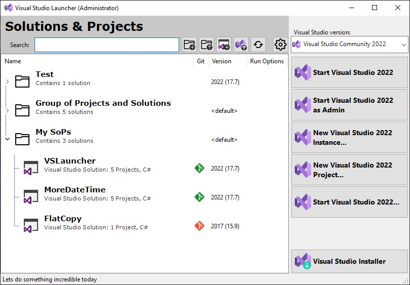
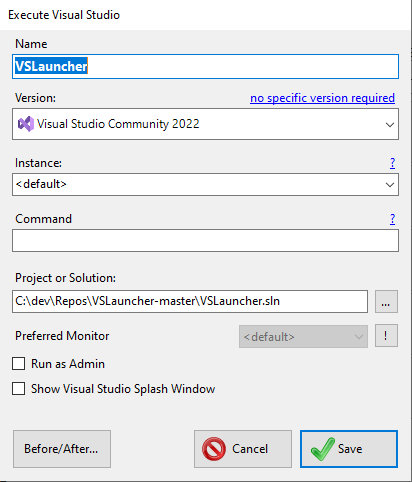

Note: for some yet unknown reason, the Visual Studio WMI classes may be removed from the WMi catalog after installing VS 2022 17.7.5

# VSLauncherX

This application is a helper application for developers who use Visual Studio, Visual Studio Code, and/or VS Code-based IDEs as their main tools for building applications.

At its core, it is a list of recently used solutions, projects, and workspaces across any currently installed Visual Studio, Visual Studio Code, or VS Code-based IDE. It can detect installed Visual Studio versions from 2017 to 2026, VS Code (Stable and Insiders, User and System installs), and other VS Code-based editors (such as Antigravity IDE, Cursor, Windsurf, VSCodium, Positron, Kiro, and Trae — plus generic `product.json` auto-discovery and manual IDE registration in Settings), including all profiles created in any of them.

Note: will use SoP as abbreviation for "Solutions and/or Projects"

## Main Features:

- Make groups of SoP's that can be used all at once
- Multi-IDE support for Visual Studio, Visual Studio Code, and VS Code-based IDEs (auto-discovered and manually registered; works even when only one IDE is installed)
- Define item specific settings like "Run as Admin", execute another application or command before and/or after Visual Studio or a VS Code-based IDE
- Use a specific Visual Studio profile or VS Code-based IDE profile (`--profile`) for each item
- Import all SoP's, `.code-workspace` files, and VS Code project folders from a directory as a group
- Launch each SoP on a defined display or monitor
- Quick search and execute (automatically expands matching groups)
- Automatically synchronize the list(s) with Visual Studio's and VS Code-based IDEs' recent lists
- Built-in sidebar quick actions and daily multi-IDE update checks with a selection dialog when multiple updates are available
- No limit on "recent files" list, can add an almost unlimited amount of SoPs
- Grouping with subgroups
- Favorites that can be invoked directly from the taskbar context menu
- Show git status of solutions/projects (Clean/Modified)
- Show admin privileges and elevation status of application
- Autostart and always run as Admin
- Light and Dark mode support

## The Why

As enterprise developer one is often in the situation to run multiple Visual Studio instances side by side, with different SoP's and configurations. 

Doing so manually is most often a tedious and time consuming process.

Also, as of late, the "Start Window" of Visual Studio is not the most helpful, besides its inherent limitations of managing its recently used list.

## Working Features
- Importing from folders (Visual Studio `.sln`/`.slnx`/projects, `.code-workspace` files, and Node.js, Python, Rust, Go, Java, CMake, Flutter, and PHP project folders)
- Importing recent items from any Visual Studio version/profile and any discovered VS Code-based IDE (`state.vscdb`)
- Support for VS 2017, 2019, 2022 and 2026 (including `.slnx` solutions)
- Support for Visual Studio Code (Stable & Insiders, User & System installs) and VS Code-based IDEs (Antigravity IDE, Cursor, Windsurf, VSCodium, Positron, Kiro, Trae, generic `product.json` + `cli.js` auto-discovery, and custom profiles)
- Manual VS Code-based IDE registration (`Add...` / `Remove`) and live `Rescan IDEs` in Settings (shared with `BackgroundLaunch` via `%AppData%\VSLauncher\vscode-custom-ides.json`)
- Tabbed IDE sidebar for Visual Studio and VS Code-based IDE quick actions (Start, Run as Admin, New Window, Start without Extensions, Open ActivityLog), with the sidebar selection acting as the default edition across launches, workspace pinning, settings, and taskbar favorites
- Daily multi-IDE update checking across all installed VS Code-based IDEs (VS Code Update API and GitHub Releases), with a multi-select update dialog when two or more IDEs have updates available
- Dedicated VS Code item settings (edition, profile, window mode, `--disable-extensions`, custom arguments, monitor, elevation, Before/After commands)
- Automatic pinning of newly added and folder-scanned `.code-workspace` entries to the active sidebar VS Code-based IDE
- Direct launching for folders configured for a VS Code-based IDE (even if empty) and a context menu `Open in` submenu listing all installed VS Code-based IDEs (or direct `Open in <IDE>` when only one is installed)
- Launching an entire group with subgroups of SoP's, each on its defined IDE version, working folder and profile
- execute other apps before and/or after each group or SoP
- Launch each SoP on a specific monitor (not 100% verified on different setups)
- Quick search and execute
- Detection of non-existing SoP's when importing from VS or VS Code
- User elevation for Run as Admin
- Run other commands before and/or after an SoP or group, optionally wait for completion before the next action
- Light and Dark mode theming

## Planned Features
- Automatically synchronize with VS
- better layout and graphics
- Taskbar integration for even quicker launching
- Support for non-Windows environments 

## How to use
First either import your recent lists from Visual Studio and VS Code using the toolbar import button, or scan a folder directly with the folder-up-arrow toolbar button. You can also drag solutions, projects, `.code-workspace` files, or folders from Explorer directly into the list.

After you have at least one SoP or workspace in the list, you can start it by pressing Enter on the selected item or double clicking it. When you double click on a folder/group, the whole folder will be launched, each item in its own IDE instance as defined in the item's settings — unless the folder itself is configured for VS Code (or contains a `.code-workspace` file), in which case it opens directly in VS Code even if the folder has no child items.

Use the tabbed right sidebar to switch between Visual Studio and VS Code-based IDE quick actions, pick the default edition (which drives default launches, workspace pinning, and taskbar favorites), open logs, or check/install updates. When updates are available for multiple VS Code-based IDEs, clicking the update button opens a checklist dialog to choose which IDE(s) to update.

Additional or portable VS Code-based IDEs can be added or removed manually in Settings (`VS Code-based IDEs`), and newly installed editors can be picked up immediately via `Rescan IDEs` without restarting.

As expected, you can use drag and drop to order items, Alt+Enter to open the item's settings (Visual Studio or VS Code settings depending on the item), Del to delete an item, etc. Remember that the settings of a folder/group item are applied before all items. This means that when you set a folder to execute as admin, all the contained SoPs will run as admin too.
You can set for each item which installed Visual Studio version or VS Code-based IDE edition (and profile) to open it with. The recommended Visual Studio version is shown as defined in the solution file, and newly added or folder-scanned `.code-workspace` entries automatically select the active sidebar VS Code-based edition.
There are also context menus that you can invoke by right clicking on an item, including `Open in` (showing a submenu of all installed VS Code-based IDEs when multiple are detected, or `Open in <IDE>` when only one is installed) to open any item or folder on demand.
When you "Favorite" an item, it is added to the Tasks context menu in the Taskbar app icon.

